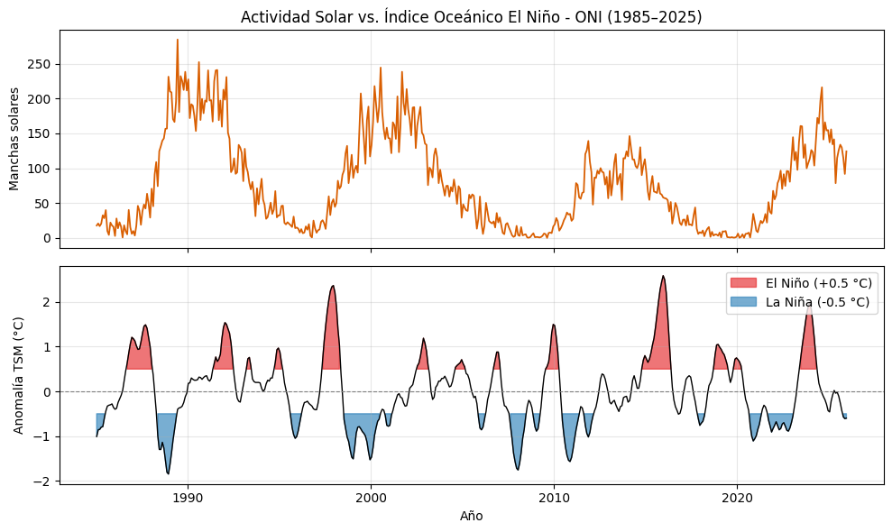
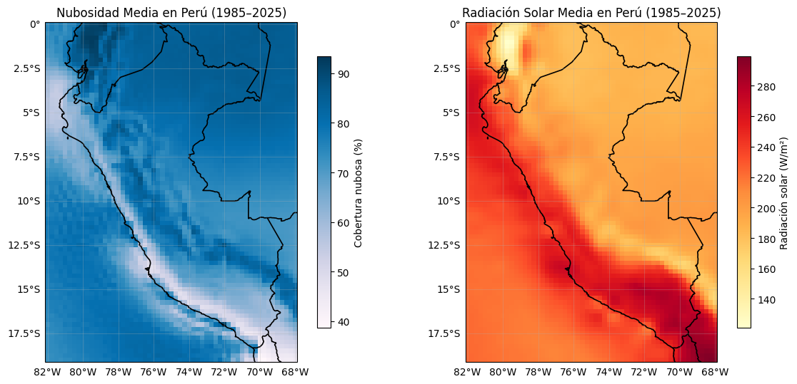
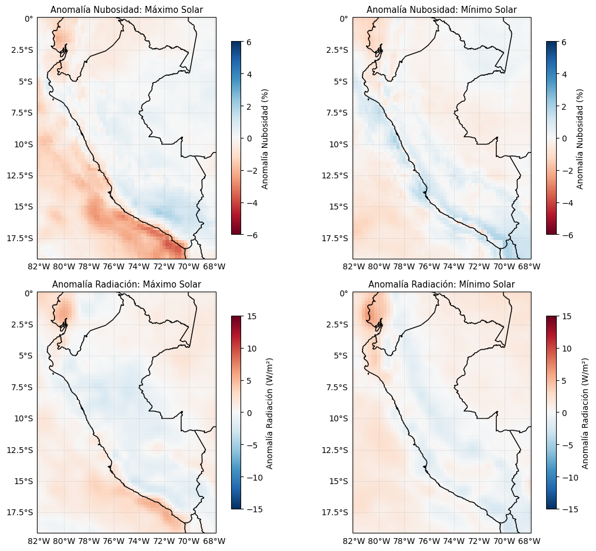
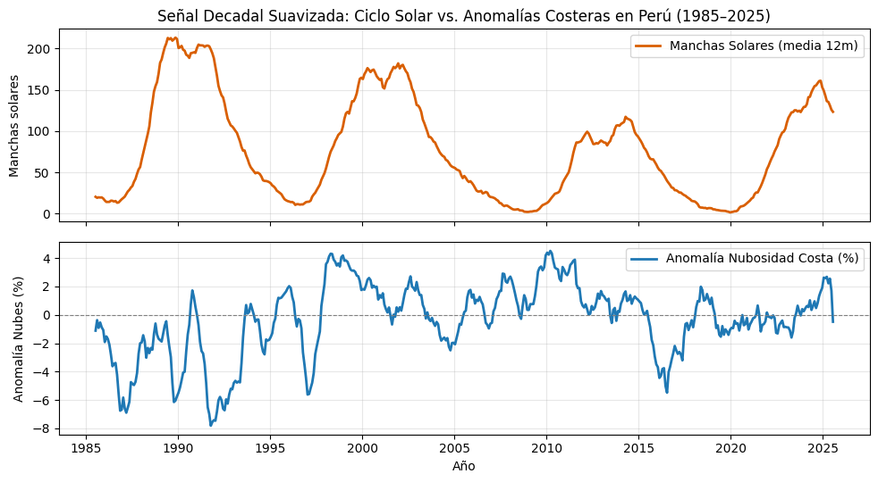

# Spatiotemporal Variability of Cloud Cover and Surface Solar Radiation in Peru: Separating Solar Cycle Signals from ENSO (1985–2025)

## Overview
This repository presents a reproducible climate data analysis evaluating 40 years (1985–2025) of monthly cloud cover and surface solar radiation anomalies across Peru in relation to the 11-year solar cycle and the El Niño–Southern Oscillation (ENSO). 

The primary objective is to isolate potential solar-terrestrial atmospheric signals from internal ocean-atmosphere variability along the arid Peruvian coast and the Andes.

## Datasets
* **Atmospheric Reanalysis:** ERA5 monthly averaged data on single levels (`tcc`: Total Cloud Cover; `ssrd`: Surface Solar Radiation Downwards) over Peru ($0^\circ$ to $19^\circ\text{S}$, $82^\circ\text{W}$ to $68^\circ\text{W}$), Copernicus Climate Data Store (CDS).
* **Solar Activity:** Monthly Mean Total Sunspot Number (V2.0), SILSO – Royal Observatory of Belgium.
* **ENSO Control Index:** Oceanic Niño Index (ONI, 3-month running mean of ERSST.v5 SST anomalies in the Niño 3.4 region), NOAA CPC.

## Key Results & Visualizations

### 1. Solar Cycles vs. ENSO Variability (1985–2025)

### 2. Peruvian Cloud Cover & Solar Radiation Climatology
ERA5 captures the sharp west-to-east orographic gradient across the Andes, with persistent cloud cover ($>80\%$) over the Amazon basin and low cloudiness ($40–55\%$) with high solar irradiance ($260–290\text{ W/m}^2$) in the southern coastal desert and Altiplano.

### 3. Composite Spatial Anomalies: Solar Maxima vs. Solar Minima

### 4. Confounding Variable Control (ENSO Filtering)
* **ENSO Dominance:** On the Central-South Peruvian coast ($10^\circ\text{S}–18^\circ\text{S}$, $81^\circ\text{W}–75^\circ\text{W}$), cloud cover anomalies show a statistically significant negative correlation with ONI ($r = -0.158, p = 0.0004$), driven by coastal stratocumulus dissipation during extreme El Niño events (1997–1998, 2015–2016).
* **Solar Signal Isolation:** Apparent composite differences between solar maxima and minima are confounded by the temporal alignment of strong El Niño events. Direct linear correlation between sunspot number and coastal cloud anomalies is non-significant across the full series ($r = -0.054, p = 0.2329$, $n = 492$) and approaches zero when filtering out ENSO phases ($r = 0.016, p = 0.8113$, $n = 235$).

## Tools & Libraries
Python 3 • `xarray` • `pandas` • `numpy` • `scipy` • `matplotlib` • `cartopy`
